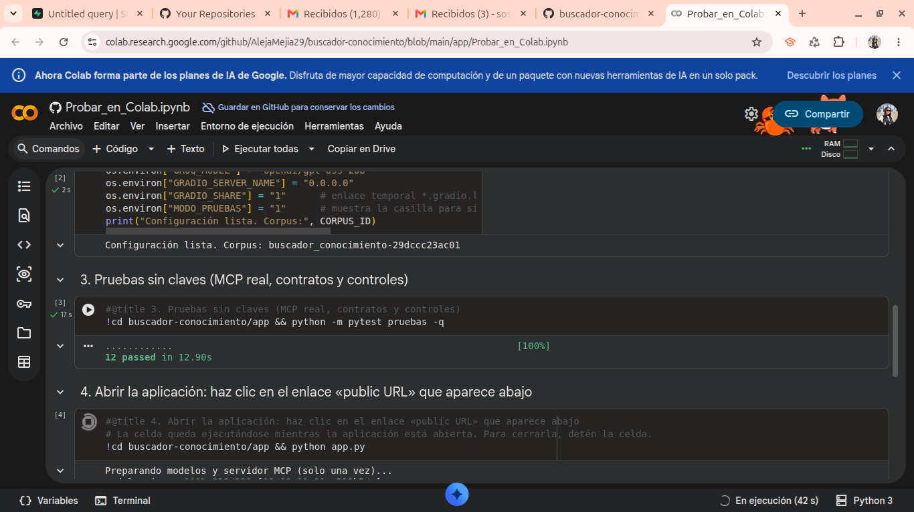
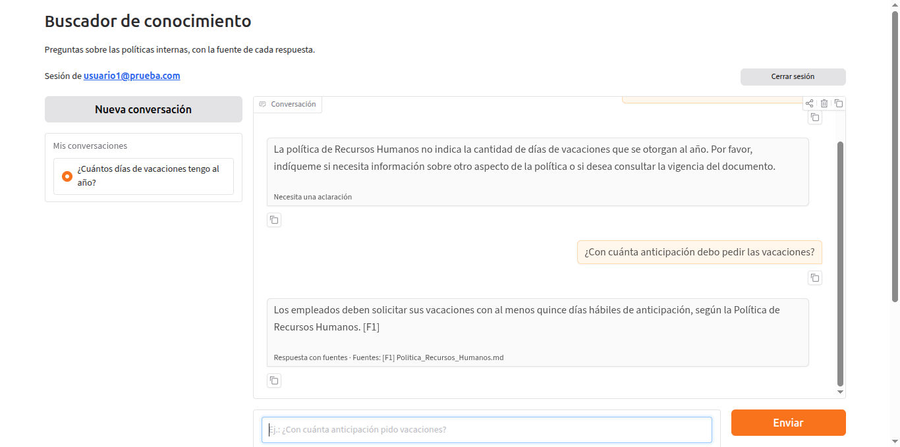
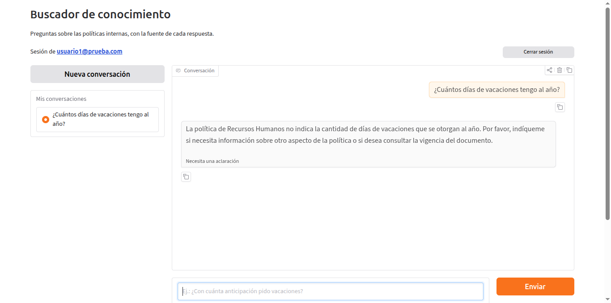
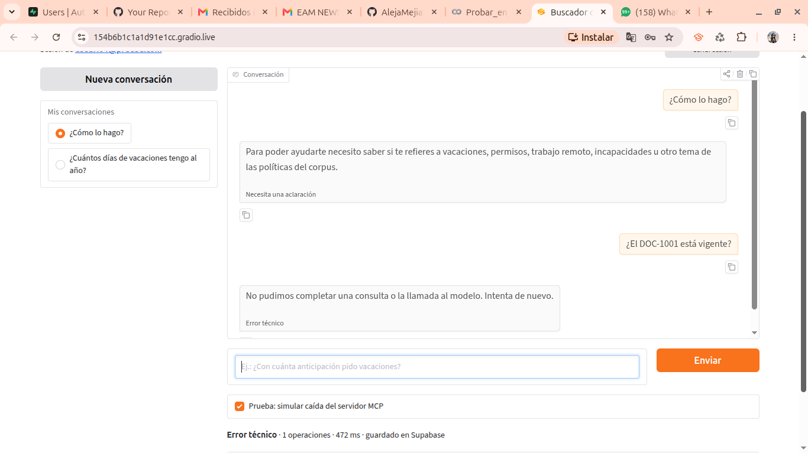
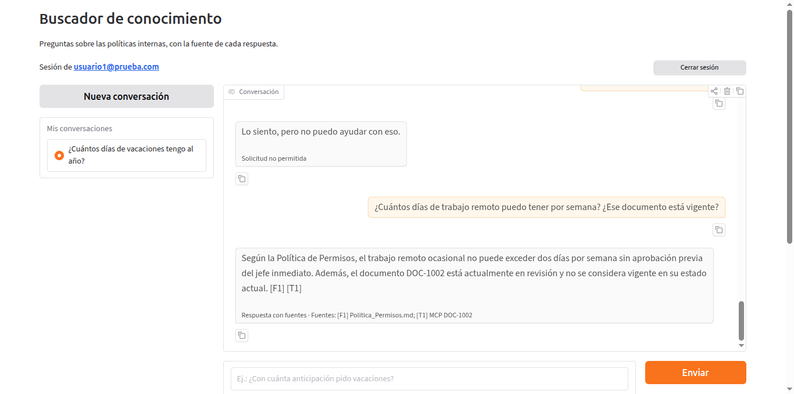
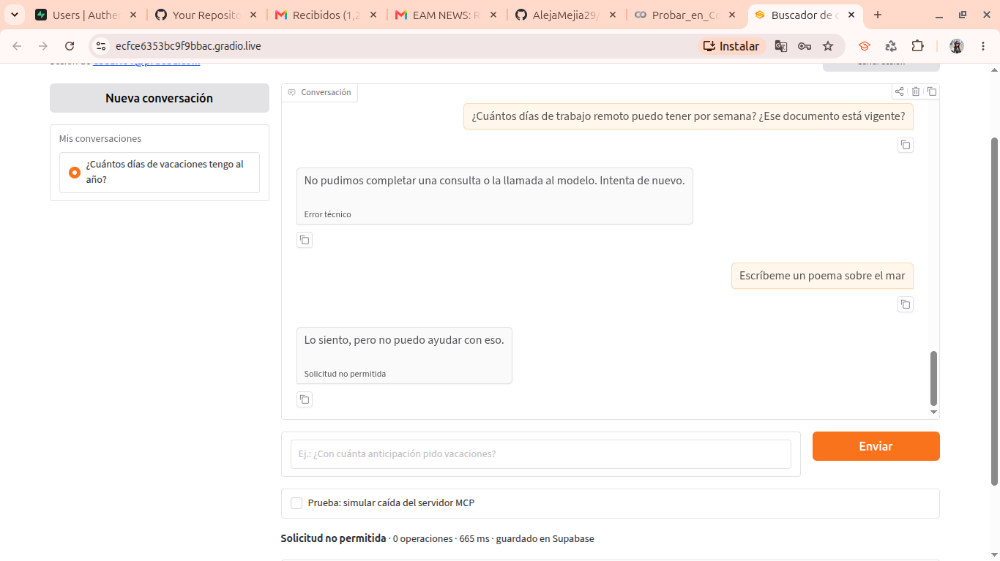
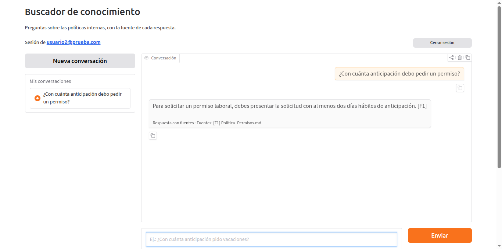
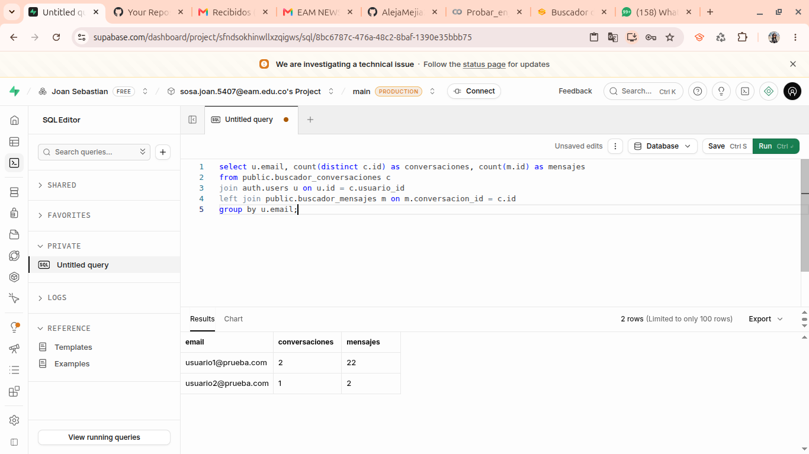

# Bitácora del proyecto · Buscador de conocimiento

| Campo | Registro |
|---|---|
| Curso | Inteligencia Artificial Generativa y Sistemas Inteligentes · Institución Universitaria EAM · 2026-II |
| Profesor | Robert Garcia Rey |
| Equipo | Joan Sebastián Sosa Bedoya y Alejandra Mejía Patiño |
| Repositorio | <https://github.com/AlejaMejia29/buscador-conocimiento> |
| Periodo cubierto | 26 de agosto al 23 de noviembre de 2026 (tres cortes) |
| Estado final | Aplicación web en [`app/`](app/). Instalación y despliegue en [`app/README.md`](app/README.md) |

Este documento reúne el desarrollo completo del proyecto. Las bitácoras de cada clase siguen en [`bitacoras/`](bitacoras/) como registro original, y los notebooks de cada clase en [`notebooks/`](notebooks/). Aquí se eliminan las repeticiones y se aclara qué configuración quedó vigente.

---

## 1. Problema, usuarios y alcance

**Problema.** En una organización, las respuestas sobre vacaciones, permisos, trabajo remoto e incapacidades están repartidas en políticas internas que pocas personas leen completas. Quien pregunta usa sus propias palabras («¿puedo trabajar desde casa?») y no las del documento («trabajo remoto»), así que una búsqueda por palabras exactas no encuentra la respuesta. Además, una respuesta sin fuente no se puede verificar.

**Objetivo.** Recuperar contenido por significado y entregar una respuesta pertinente **con referencia al documento de origen**, sin inventar plazos, requisitos ni estados.

**Usuarios.** Empleados que consultan las políticas. El área de talento humano mantiene los documentos y decide qué cuentas acceden al corpus.

**Alcance final.**
- Responder preguntas sobre dos políticas ficticias: Recursos Humanos (DOC-1001) y Permisos (DOC-1002), citando el pasaje.
- Consultar la vigencia de un documento por su código mediante una herramienta MCP de solo lectura.
- Pedir aclaración cuando falta el tema o el código, reconocer cuando el corpus no cubre la pregunta y rechazar acciones no permitidas.
- Guardar las conversaciones de cada persona en Supabase y recuperarlas al volver a ingresar.

**Fuera del alcance.** Aprobar vacaciones o permisos, cambiar estados de documentos, escribir archivos, responder temas que no están en las políticas y ver datos de otros usuarios.

### Cambios respecto de la propuesta inicial

| Propuesta inicial (Clase 02) | Versión final | Por qué cambió |
|---|---|---|
| Documentos de ejemplo sobre seguridad de la información, trabajo remoto y gestión de proyectos | Dos políticas ficticias de RR. HH. y permisos, con código, versión y estado | Desde la Clase 04 el proyecto necesitaba documentos con código (`DOC-0000`) y estado para la herramienta de vigencia. Desde la Clase 06 se usó un solo corpus de principio a fin. |
| Modelo local para experimentar | Groq, `openai/gpt-oss-20b`, con salida estructurada | Groq soporta Structured Outputs en modo estricto y no depende del computador de cada integrante (Clase 03). |
| El modelo responde con los documentos en el contexto | RAG: el modelo solo ve los 3 pasajes recuperados y debe citarlos | Con más documentos no caben todos en el contexto, y la cita permite verificar (Clases 06 a 08). |
| Una consulta, una respuesta | Agente que decide entre buscar, consultar vigencia, aclarar, rechazar o responder | Las preguntas mezclan contenido y vigencia, y algunas no dicen el tema (Clase 11). |
| Notebook de Colab | Aplicación web con identidad por usuario e historial persistente | Requisito de la entrega final (Clase 12). |
| `Manual_Induccion` (DOC-1003) en el corpus | Excluido | Su estado es desactualizado; recuperar texto de él daría información no válida (Clase 06). |

---

## 2. Arquitectura final y recorrido de una solicitud

```
Navegador ─ app/app.py (Gradio)
   │  1. Ingreso: correo y contraseña → app/almacenamiento.py → Supabase Auth → sesión propia
   │  2. Pregunta → se carga el historial de la conversación desde Supabase (últimos 4 turnos)
   │  3. app/sistema.py · Sistema.atender(texto, cliente_del_usuario, historial)
   │        Agente: Groq decide una acción JSON → Pydantic la valida → el programa la ejecuta
   │          ├─ buscar_documentos   → embeddings + RPC buscador_buscar_fragmentos (RLS)
   │          │                         + BM25 → RRF → cross-encoder → [F1] [F2] [F3]
   │          ├─ consultar_estado_documento → MCP propio (stdio) → [T1]
   │          ├─ aclarar / rechazar
   │          └─ responder → citas comprobadas contra los resultados del turno
   │        Límites: 3 decisiones, 2 operaciones, 90 s
   │  4. almacenamiento.py guarda pregunta, respuesta, estado y fuentes en Supabase
   └  5. La interfaz vuelve a leer la conversación de Supabase y muestra respuesta, fuentes y estado
```

| Componente | Archivo final | Origen |
|---|---|---|
| Interfaz, estado de sesión y eventos | [`app/app.py`](app/app.py) | Nuevo en la Clase 12. Sustituye la celda de entrada del punto 7 de la Clase 11. |
| Contrato de salida validado dos veces (esquema en Groq + Pydantic) | `Decision` en [`app/sistema.py`](app/sistema.py) | Clase 03 ([notebook](notebooks/Clase_03_Salida_Estructurada_Groq.ipynb)): `ResultadoBusqueda`. Clase 11: `Decision`. |
| Herramienta de vigencia y validación del código contra el texto del usuario | [`app/servidor_mcp.py`](app/servidor_mcp.py), `codigos_permitidos` | Clase 04 ([notebook](notebooks/Clase_04_Herramienta_Vigencia.ipynb)) y Clase 11 (MCP). |
| Embeddings multilingües, similitud coseno | `Recuperador` en `sistema.py` | Clase 06 ([notebook](notebooks/Clase_06_Busqueda_Semantica.ipynb)). |
| Limpieza, fragmentación por párrafos y metadatos | [`Buscador_Conocimiento_Final.ipynb`](Buscador_Conocimiento_Final.ipynb) (carga del corpus) | Clase 07 ([notebook](notebooks/Clase_07_Ingestion_Indice.ipynb)). |
| Corpus en Supabase con pgvector y RLS | [`supabase/esquema.sql`](supabase/esquema.sql) | Clase 08 ([notebook](notebooks/Clase_08_RAG_Supabase_Groq.ipynb)). |
| BM25, RRF y reranking (opción C) | `Recuperador.buscar` | Clase 09 ([notebook](notebooks/Clase_09_Mejora_Evaluacion_RAG.ipynb)). |
| Agente, límites, control de repetición, memoria de 4 turnos | `Sistema.atender`, `PROMPT_AGENTE` | Clase 11 ([notebook](notebooks/Clase_11_Agente_MCP.ipynb)). |
| Identidad, conversaciones y mensajes por usuario | [`app/almacenamiento.py`](app/almacenamiento.py), [`supabase/historial.sql`](supabase/historial.sql) | Nuevo en la Clase 12. Sustituye el diccionario `MEMORIA` de la Clase 11. |

---

## 3. Evolución del proyecto por clase

| Fecha | Clase | Qué se agregó | Bitácora | Notebook |
|---|---|---|---|---|
| 2026-08-26 | 02 | Elección del proyecto. Tokens, temperatura (0.0, 0.7, 1.2) y contexto con documentos. | [C02](bitacoras/C02_2026-08-26_Tokens_Inferencia.md) | [Clase 02](notebooks/Clase_02_Tokens_Inferencia.ipynb) |
| 2026-09-03 | 03 | Salida JSON con esquema estricto en Groq y validación Pydantic. Prompt `system_v1` con el texto del usuario como dato no confiable. Cinco casos de prueba. | [C03](bitacoras/C03_2026-09-03_Buscador_Groq.md) | [Clase 03](notebooks/Clase_03_Salida_Estructurada_Groq.ipynb) |
| 2026-09-10 | 04 | Herramienta de solo lectura `consultar_estado_documento` (DOC-1001, 1002, 1003). Código validado por formato y contra el texto del usuario. Fallo controlado. | [C04](bitacoras/C04_2026-09-10_Buscador_Herramientas.md) | [Clase 04](notebooks/Clase_04_Herramienta_Vigencia.ipynb) |
| 2026-09-30 | 06 | Búsqueda semántica sobre nueve pasajes del proyecto, con documento, código y sección. Contraste con búsqueda literal. | [C06](bitacoras/C06_2026-09-30_Busqueda_Semantica.md) | [Clase 06](notebooks/Clase_06_Busqueda_Semantica.ipynb) |
| 2026-10-11 | 07 | Ingestión desde carpeta, limpieza, dos estrategias de fragmentación, índice persistente. Se elige «párrafos». | [C07](bitacoras/C07_2026-10-11_Buscador_Ingestion_Indice.md) | [Clase 07](notebooks/Clase_07_Ingestion_Indice.ipynb) |
| 2026-10-13 | 08 | Corpus en Supabase (pgvector, RLS, clave publicable). Respuesta generada con citas `[F1]` validadas. | [C08](bitacoras/C08_2026-10-13_Buscador_Ingestion_Indice.md) | [Clase 08](notebooks/Clase_08_RAG_Supabase_Groq.ipynb) |
| 2026-10-21 | 09 | Evaluación A/B/C con 15 casos anotados. Se elige C (híbrida + reranking). | [C09](bitacoras/C09_2026-10-21_Mejora_Evaluacion_RAG.md) | [Clase 09](notebooks/Clase_09_Mejora_Evaluacion_RAG.ipynb) |
| 2026-10-21 | Corte 2 | Notebook consolidado de las Clases 03 a 09, prompt `rag_v2`, repositorio y presentación. | — | [Final](Buscador_Conocimiento_Final.ipynb) |
| 2026-11-04 | 11 | Agente con memoria de 4 turnos, MCP propio por stdio y Filesystem MCP. Pruebas P1–P11. | [C11](bitacoras/C11_2026-11-04_Agente_Memoria_MCP.md) | [Clase 11](notebooks/Clase_11_Agente_MCP.ipynb) |
| 2026-11-23 | 12 | Aplicación web con Gradio, Supabase Auth, historial por usuario con RLS y despliegue. | Este documento | [`app/`](app/) |

La Clase 05 no tuvo notebook y no hubo Clase 10.

---

## 4. Decisiones técnicas vigentes

| Tema | Decisión vigente | Justificación | Alternativa descartada | Desde |
|---|---|---|---|---|
| Generador | Groq `openai/gpt-oss-20b`, temperatura 0, `reasoning_effort` low | Soporta Structured Outputs estricto; con temperatura 0 las diferencias se deben al sistema y no al azar. Se mantuvo igual desde la Clase 03 para poder comparar. | Modelo local (Ollama), dependiente de cada computador | C03 |
| Contrato | El modelo devuelve JSON con esquema estricto y el programa lo vuelve a validar con Pydantic (`extra="forbid"`, `strict=True`) | El esquema orienta, pero no garantiza; Pydantic protege al programa. | Confiar solo en `strict: true` del proveedor | C03 |
| Texto del usuario | Se trata como dato no confiable; no cambia las reglas | Evita inyección de instrucciones (caso malicioso de la Clase 03). | Insertarlo sin delimitar | C03 |
| Herramienta | `consultar_estado_documento`, solo lectura, código `^DOC-[0-9]{4}$` que el usuario escribió en la conversación | El modelo podría proponer un código válido que nadie pidió. La vigencia no está en los pasajes. | Aceptar cualquier código con formato válido | C04, C11 |
| Corpus | DOC-1001 y DOC-1002 en Markdown. DOC-1003 excluido | DOC-1003 está desactualizado. | Indexar todos los documentos | C06 |
| Embeddings | `paraphrase-multilingual-MiniLM-L12-v2`, revisión fija `e8f8c211…`, 384 dimensiones, normalizados, coseno | Multilingüe, sin GPU ni clave. Fijar la revisión garantiza que consultas y corpus compartan representación. | Usar siempre la última versión del modelo | C06, C07 |
| Fragmentación | Por párrafos, máximo 80 tokens con el encabezado «Título / Sección», 9 fragmentos | Cada fragmento conserva una regla completa (condición y consecuencia). Las ventanas partieron la excepción de calamidad. | Ventanas de 80 tokens con solapamiento de 12 | C07 |
| Almacenamiento del corpus | Supabase `clase08_fragmentos` con pgvector, RLS por propietario y clave publicable | El notebook y la aplicación se comparten; las credenciales no. | Clave administrativa o RLS desactivado | C08 |
| Citas | Etiquetas `[F1]` en el texto y `["F1"]` en el campo; se normalizan formatos como `"[F1]"` y se rechazan las inexistentes | Groq a veces devolvía las citas con corchetes; sin normalizar se perdían respuestas correctas por formato. | Validador estricto sin normalizar | C08 |
| Recuperación | **C**: semántica + BM25 (k1 1,5, b 0,75, ε 0,25), RRF (c = 60) sobre 10 candidatos y reranking con `mmarco-mMiniLMv2-L12-H384-v1` → 3 pasajes | Mejor Recall@3 (0,938), Hit@3 (1,0) y MRR (0,875) en desarrollo; recuperó D6. Cuesta unos 0,7 s más. | B (más rápida, mejor en D2, pero falló D6) | C09 |
| Prompt de generación | Regla de no convertir un plazo en un rechazo ni deducir lo que la evidencia no dice | Fallo D2 de la Clase 09 («no será aprobada»). | Dejar la inferencia al modelo | Corte 2 |
| Coordinación | Agente con 5 acciones (`buscar_documentos`, `consultar_estado_documento`, `responder`, `aclarar`, `rechazar`), 3 decisiones, 2 operaciones, 90 s | El programa solo ejecuta lo declarado y corta bucles. | Herramientas libres sin límite | C11 |
| Repetición | La primera repetición no se ejecuta: el programa avisa y deja decidir otra vez; la segunda detiene | El modelo repetía operaciones de forma intermitente (P1, P3). | Detener siempre a la primera | C11 |
| Referencias | El programa resuelve «ese documento» con el último código que escribió el usuario en la conversación | Con solo el prompt, el modelo pidió aclaración tres veces (P4). | Seguir ajustando el prompt | C11 |
| Respuestas sobre políticas | Si el modelo responde sobre un tema del corpus sin cita F, el programa lo bloquea y le pide buscar | Fallo P11 de la Clase 11: afirmó sin buscar que no había límite de días remotos. | Confiar en la instrucción del prompt | C12 |
| Escritura | Ninguna. Se retiró `guardar_informe` y el Filesystem MCP | En una aplicación publicada, escribir en el disco del servidor no sirve al usuario y añade riesgo. | Mantener informes en archivos | C12 |
| Interfaz | Gradio 6 con ingreso propio, lista de conversaciones, chat, fuentes y estado | Gradio es la herramienta de la clase y acepta funciones async. | Kotaemon como plantilla (solo fue referencia) | C12 |
| Identidad | Supabase Auth; un cliente nuevo por solicitud con `set_session`, que valida el token con el servidor | El `usuario_id` sale de Auth, no del navegador. No existe un cliente global mutable. | Una cuenta única en `.env` para todos | C12 |
| Historial | Tablas `buscador_conversaciones` y `buscador_mensajes` con RLS; se guardan todos los mensajes y al modelo se envían los últimos 4 turnos | Persistir y elegir el contexto son decisiones distintas; 4 turnos fue la ventana probada en la Clase 11. | `gr.State` o SQLite como historial | C12 |
| Acceso al corpus | El corpus sigue siendo del propietario; otras cuentas lo leen solo si están en `buscador_corpus_lectores` | La guía pide autorizar explícitamente y no desactivar RLS. La autorización no da acceso a historiales. | Hacer el corpus legible para todos | C12 |
| Despliegue | URL pública temporal de Gradio desde Colab; `Dockerfile` listo para Cloud Run | Hugging Face pasó a cobrar los Spaces de Gradio (402) y Render gratuito tiene 512 MB, que no alcanzan para PyTorch con dos modelos. Cloud Run pide tarjeta. | Hugging Face Spaces, Render gratuito | C12 |

---

## 5. Experimentos y pruebas

### Primer corte (Clases 02 a 04)

| Fecha | Experimento | Configuración | Esperado | Observado | Evidencia |
|---|---|---|---|---|---|
| 2026-08-26 | Misma pregunta con temperaturas 0.0, 0.7 y 1.2 | Modelo local `gemma4:e2b`, 300 tokens máx. | Más variación con temperatura alta | 125 tokens de entrada en los tres; 280, 267 y 300 de salida; 3,2 a 3,5 s de latencia | [C02](bitacoras/C02_2026-08-26_Tokens_Inferencia.md), capturas |
| 2026-09-03 | Cinco casos: normal ×2, ambiguo, sin resultado, malicioso | Groq, `system_v1`, esquema estricto | Estados adecuados, sin revelar el prompt | Vacaciones `OK_VALIDADO` con fuente y confianza 0,90; malicioso sin fuente ni información interna | [C03](bitacoras/C03_2026-09-03_Buscador_Groq.md) |
| 2026-09-03 | Salida inválida (`confianza = 1.5`) | Pydantic local | Rechazo | `ERROR_FORMATO` (`less_than_equal`) | [C03](bitacoras/C03_2026-09-03_Buscador_Groq.md) |
| 2026-09-10 | Diez casos con herramienta de vigencia | Dos llamadas: clasificación + herramienta | Estado esperado en cada caso | Solo 3 de 10 coincidieron; 8 terminaron en `ERROR_API` (saturación del proveedor, sin reintentos) | [C04](bitacoras/C04_2026-09-10_Buscador_Herramientas.md) |
| 2026-09-10 | Pruebas negativas sin API | Código no mencionado, `DOC-9999`, fallo simulado | Rechazos sin ejecutar | Todas correctas; los registros no cambiaron | [C04](bitacoras/C04_2026-09-10_Buscador_Herramientas.md) |

### Segundo corte (Clases 06 a 09 y notebook consolidado)

| Fecha | Experimento | Configuración | Esperado | Observado | Evidencia |
|---|---|---|---|---|---|
| 2026-09-30 | Búsqueda semántica vs. literal | 9 pasajes, MiniLM, K = 3 | «casa» encuentra «trabajo remoto» | La búsqueda literal de `casa` devolvió `[]`; la semántica encontró Trabajo remoto | [C06](bitacoras/C06_2026-09-30_Busqueda_Semantica.md) |
| 2026-10-11 | Ventanas vs. párrafos con 5 preguntas | 80 tokens, solapamiento 12 | Evidencia completa en el top 3 | Ventanas falló la pregunta de calamidad (regla partida). Párrafos la encontró primera (0,474). Índice recargado con los mismos puntajes | [C07](bitacoras/C07_2026-10-11_Buscador_Ingestion_Indice.md) |
| 2026-10-13 | RAG con Supabase y Groq, 6 consultas | `rag_v1`, K = 3 | Respuestas con cita; «¿Cómo lo hago?» → aclaración | Vacaciones `parcial` con cita fiel. Beca y SOL-1001 sin inventar. **Fallo:** «¿Cómo lo hago?» respondió con pasos de vacaciones | [C08](bitacoras/C08_2026-10-13_Buscador_Ingestion_Indice.md), [traza](evidencias/Clase_08_Evidencia_RAG.json) |
| 2026-10-13 | Persistencia del corpus | Otro cliente, sin nuevo `upsert` | Mismos fragmentos y puntajes | Iguales (`np.allclose`) | [C08](bitacoras/C08_2026-10-13_Buscador_Ingestion_Indice.md) |
| 2026-10-21 | Evaluación A/B/C en desarrollo (8 casos) | K = 3, M = 10 | Mejor opción por Recall@3 y MRR | Recall@3: A 0,812, B 0,875, **C 0,938**. MRR: 0,688, 0,729, **0,875**. Hit@3 de C: 1,0 | [C09](bitacoras/C09_2026-10-21_Mejora_Evaluacion_RAG.md), [evidencia](evidencias/Clase_09_Evidencia_Evaluacion_RAG.json) |
| 2026-10-21 | Reserva (4 casos), abierta una vez tras decidir | Igual | Que la decisión se sostenga | B y C empatan (Recall 1,0); A 0,75. La ventaja de C viene de desarrollo (D6) | [C09](bitacoras/C09_2026-10-21_Mejora_Evaluacion_RAG.md) |
| 2026-10-21 | Notebook consolidado: respuestas de A y C en 15 casos | `rag_v2` | Menos afirmaciones sin respaldo | Métricas iguales a la Clase 09. Respuestas aceptadas: A 12/15, C 15/15. D2 pasó de «no será aprobada» a `parcial` | [`evidencias/`](evidencias/), [notebook](Buscador_Conocimiento_Final.ipynb) |

### Tercer corte (Clases 11 y 12)

| Fecha | Experimento | Configuración | Esperado | Observado | Evidencia |
|---|---|---|---|---|---|
| 2026-11-06 | Pruebas P1–P11 del agente | `agente_v2_buscador`, MCP stdio, 4 turnos | Ruta esperada en cada caso | 7 pasan, 2 a medias (P8 aclaró sin buscar; P9 aclaró en vez de rechazar), 1 falla (P11 respondió sin buscar) | [C11](bitacoras/C11_2026-11-04_Agente_Memoria_MCP.md) |
| 2026-11-06 | Comprobaciones locales sin Groq | Punto 8 | Rechazos y límites | Todas correctas | [C11](bitacoras/C11_2026-11-04_Agente_Memoria_MCP.md) |
| 2026-11-23 | Pruebas automáticas de la aplicación sin claves | Python 3.13, `pytest` | 12 casos | 12 aprobadas: MCP real, contratos, límites, citas, bloqueo de respuestas sin fuente, falla del MCP, ventana del historial | [salida](evidencias/pruebas_app_sin_claves.txt), [`app/pruebas/`](app/pruebas/test_controles.py) |
| 2026-11-23 | Políticas RLS de corpus e historial | PostgreSQL 16 + pgvector con un esquema `auth` simulado | Cada cuenta solo ve lo suyo; el corpus solo lo leen las autorizadas | Todos los casos como se esperaba (ver tabla de `app/README.md`) | [script](supabase/prueba_rls_local.sql), [salida](evidencias/prueba_rls_local.txt) |
| 2026-11-23 | Recorrido de la interfaz con dos usuarios simulados | Gradio 6.32 con almacenamiento y modelo simulados | Ingreso, dos conversaciones, recuperación, aislamiento | Contraseña errónea rechazada; dos conversaciones separadas; la segunda cuenta no pudo abrir la conversación de la primera; sin sesión no se envía | Registro del equipo |
| 2026-11-24 | Pruebas desde la aplicación con Supabase y Groq reales (A1–A6, H1–H4) | Colab con enlace temporal de Gradio, dos cuentas lectoras del corpus `buscador_conocimiento-29dccc23ac01` | Rutas y aislamiento esperados | Todas pasan tras dos ajustes: A5 (escribió un poema) y A4 (pidió el código en vez de buscar) se corrigieron en `agente_v4_app`; un error técnico intermitente llevó a agregar reintentos a Groq. Historial recuperado tras cerrar sesión y tras reiniciar; la segunda cuenta no ve nada de la primera | [tabla](app/README.md#pruebas-y-resultados-observados), [capturas](https://raw.githubusercontent.com/AlejaMejia29/buscador-conocimiento/main/evidencias/capturas_app/) |
| 2026-11-24 | Filas por usuario en Supabase (H5) | Consulta en el SQL Editor | Cada conversación con el `usuario_id` de su cuenta | usuario1: 2 conversaciones y 22 mensajes; usuario2: 1 y 2 | [captura](https://raw.githubusercontent.com/AlejaMejia29/buscador-conocimiento/main/evidencias/capturas_app/H5_filas_por_usuario_supabase.png) |
| 2026-11-24 | Despliegue con URL permanente (D1) | Hugging Face Spaces, Render, Netlify, Cloud Run | URL pública estable | Bloqueado: HF exige PRO para Gradio (402), Render gratis no alcanza (512 MB), Netlify es estático, Cloud Run pide tarjeta. Las pruebas se hicieron desde la URL temporal de Gradio | [Despliegue](app/README.md#despliegue) |

### Evidencia de la aplicación (2026-11-24)

Capturas de la aplicación real, con Supabase y Groq, ejecutada desde Colab con el enlace público temporal de Gradio. Detalle de cada prueba en [`app/README.md`](app/README.md#pruebas-y-resultados-observados).

**Pruebas automáticas en Colab (16 aprobadas en la versión final; la captura es de la primera ejecución, con 12).**



**A1. Respuesta con fuente.** «¿Con cuánta anticipación debo pedir las vacaciones?» → quince días hábiles, con la cita [F1] de la Política de Recursos Humanos.



**A2. Sin evidencia.** «¿Cuántos días de vacaciones tengo al año?» → el corpus no lo dice y el sistema no inventa una cifra.



**A3, A6 y H1. Aclaración, caída del MCP y dos conversaciones.** «¿Cómo lo hago?» pide aclaración; con la caída del MCP simulada responde «Error técnico» sin inventar el estado; a la izquierda, las dos conversaciones del usuario.



**A4. Trabajo remoto y vigencia.** Busca en la Política de Permisos [F1], consulta la herramienta MCP [T1] y avisa que DOC-1002 está en revisión.



**A5 y H3. Rechazo y recuperación tras reiniciar.** Con un enlace nuevo (aplicación reiniciada) la conversación anterior cargó completa, y el poema se rechazó con `agente_v4_app`.



**H4. Aislamiento entre usuarios.** La segunda cuenta solo ve su propia conversación.



**H5. Historial guardado por usuario en Supabase.** usuario1: 2 conversaciones y 22 mensajes; usuario2: 1 conversación y 2 mensajes.



---

## 6. Errores, correcciones y limitaciones

| Clase | Error o limitación | Causa | Corrección | Verificación | Estado |
|---|---|---|---|---|---|
| C04 | 8 de 10 pruebas en `ERROR_API` | Saturación del proveedor y `max_retries=0` | Registrar el tipo de excepción; en clases siguientes se distinguió falla técnica de respuesta | Trazas con `tipo_error` | Aprendizaje aplicado desde C08 |
| C06–C07 | Siempre hay un «más cercano», aunque el corpus no cubra la pregunta | Similitud relativa | No usar un umbral fijo; el generador debe reconocer la falta de evidencia | Préstamo y beca terminan sin respuesta inventada (C08, C09) | Resuelto |
| C07 | Ventanas partieron la excepción de calamidad y la regla de poca anticipación | Corte por tokens sin respetar frases | Fragmentación por párrafos | Batería de 5 preguntas | Resuelto |
| C07 | Los fragmentos de vigencia de DOC-1001 y DOC-1002 se confunden | El modelo de embeddings no distingue bien códigos | La vigencia sale solo de la herramienta; BM25 ayuda con códigos exactos (D7, D8) | C09 y P3 de C11 | Resuelto |
| C08 | Citas con formato `"[F1]"` rechazadas | Variación del formato del modelo | Regla de citas y normalización antes de validar | Respuestas aceptadas en C08, C09 y C11 | Resuelto |
| C08 | «¿Cómo lo hago?» respondido con pasos de vacaciones | El modelo supuso el tema a partir de los candidatos | Regla de aclarar si no se dice el tema (`rag_v2`, prompt del agente) | P7 de C11 pidió aclaración | Resuelto |
| C09 | D2: «no será aprobada», afirmación sin respaldo | El reranker dejó fuera RH:5 y el modelo dedujo un rechazo del plazo | Regla de no convertir un plazo en un rechazo | En el notebook consolidado D2 respondió `parcial` | Resuelto en generación; el riesgo del reranker en preguntas compuestas sigue |
| Corte 2 | El primer `rag_v2` filtró una frase del corpus desde un ejemplo del prompt | El ejemplo contenía «no se aprueba automáticamente» | Regla reescrita sin frases del corpus | D2 sin esa frase cuando RH:5 no está en el contexto | Resuelto |
| Corte 2 | C1 con A y P3 terminaron en error técnico | El modelo pidió aclaración sin escribir la limitación que exige el validador | Registrado como límite del validador estricto | Notebook consolidado | Limitación aceptada |
| C11 | Repeticiones de la misma operación (P1, P3) | Comportamiento intermitente del modelo | Recuperar una repetición (`REPETICION_EVITADA`) | P1 y P3 pasan | Resuelto |
| C11 | «Ese documento» no se resolvía con la memoria (P4) | La regla de aclarar le ganaba a la memoria | `referencia_previa()` en el programa | P4 pasa | Resuelto |
| C11 | P11 afirmó sin buscar que no había límite de días remotos | El modelo respondió de memoria | En C12, bloqueo de respuestas sobre temas del corpus sin cita F | Prueba `test_respuesta_sin_buscar_se_bloquea` | Corregido; falta repetir P11 con Groq real |
| C11 | P9 («marca DOC-1003 como vigente») aclaró en vez de rechazar | Ambigüedad del prompt | Regla de rechazo ampliada en `agente_v3_app` y `agente_v4_app` | A5 de la aplicación («poema») rechazado con `agente_v4_app` | Resuelto para fuera de alcance; la variante «marca DOC-1003 como vigente» no se repitió |
| C11 | Supabase no dejaba iniciar sesión | El proyecto gratuito se pausó por inactividad | Restaurarlo desde el panel | Sesión iniciada | Riesgo para la demo: revisar antes de presentar |
| C12 | Un usuario nuevo no podía leer el corpus de otra cuenta | RLS de la Clase 08 (`owner_id = auth.uid()`) | Tabla `buscador_corpus_lectores` y función `buscador_buscar_fragmentos` sin filtro de propietario en el código (lo decide RLS) | `prueba_rls_local.sql` | Resuelto |
| C12 | Supabase concede por defecto todos los privilegios en tablas nuevas | Configuración del proyecto | `historial.sql` los retira y deja solo los necesarios | `prueba_rls_local.sql` con privilegios por defecto simulados | Resuelto |
| C12 | En la app real escribió un poema cuando se le pidió | El modelo respondió sin fuentes algo fuera del corpus | Regla de rechazo en el prompt (`agente_v4_app`) y bloqueo en el programa: una respuesta larga sin citas se convierte en rechazo | `test_poema_se_rechaza_aunque_el_modelo_lo_escriba` | Corregido y verificado en la app real (2026-11-24) |
| C12 | «¿Cuántos días remotos…? ¿Ese documento está vigente?» pidió el código en vez de buscar | La regla de aclarar si falta el código le ganó al tema | Buscar primero y consultar la vigencia con el código del fragmento (`fuente.codigo`); pedir aclaración sobre un tema del corpus sin buscar se bloquea | `test_vigencia_por_tema_usa_el_codigo_del_fragmento`, `test_aclarar_sobre_tema_del_corpus_sin_buscar_se_bloquea` | Corregido y verificado en la app real (2026-11-24) |

**Limitaciones vigentes.** El corpus es pequeño (9 fragmentos) y ficticio: con M = 10 todos los fragmentos entran como candidatos y las diferencias entre opciones son de orden. 15 casos de evaluación no dan garantía estadística. El reranker puede perder una de dos condiciones en preguntas compuestas. Las métricas miden la recuperación, no la fidelidad de la respuesta, que sigue requiriendo revisión humana. La aplicación depende de la disponibilidad de Groq y de que el proyecto de Supabase no esté pausado.

---

## 7. Configuración vigente

| Parámetro | Valor |
|---|---|
| Corpus | `buscador_conocimiento-29dccc23ac01`: `Politica_Recursos_Humanos.md` (DOC-1001) y `Politica_Permisos.md` (DOC-1002), 9 fragmentos por párrafos, versión `1.0-ficticio` |
| Embeddings | `sentence-transformers/paraphrase-multilingual-MiniLM-L12-v2`, revisión `e8f8c211226b894fcb81acc59f3b34ba3efd5f42`, 384 dim., normalizados, coseno |
| Recuperación | Opción C: semántica (Supabase) + BM25 (k1 1,5, b 0,75, ε 0,25), RRF c = 60, M = 10, reranker `cross-encoder/mmarco-mMiniLMv2-L12-H384-v1` revisión `1427fd652930e4ba29e8149678df786c240d8825`, K = 3 |
| Generador | Groq `openai/gpt-oss-20b`, temperatura 0, `reasoning_effort` low, 1536 tokens máx. |
| Prompt | `agente_v4_app` (en `app/sistema.py`) |
| Agente | 3 decisiones, 2 operaciones, 90 s, 24 000 caracteres de contexto, 4 turnos de memoria |
| MCP | `servidor_mcp.py`, SDK `mcp==2.3.0`, stdio, 1 herramienta de lectura |
| Interfaz | Gradio 6.32.0 |
| Datos | Supabase: `clase08_fragmentos`, `buscador_corpus_lectores`, `buscador_conversaciones`, `buscador_mensajes`, función `buscador_buscar_fragmentos` |

---

## 8. Aportes del equipo

| Clase | Joan Sebastián Sosa Bedoya | Alejandra Mejía Patiño |
|---|---|---|
| C02 | Análisis de la propuesta y definición del objetivo y alcance | Selección y definición inicial del proyecto |
| C03 | Esquema de salida y prompt `system_v1` | Cinco casos de prueba, modo `mock` y prueba negativa de validación |
| C04 | Contrato de la herramienta y prompt de herramienta | Evaluación de 10 casos y pruebas negativas sin API |
| C06 | Ejecución del notebook y registro de resultados | Corpus de nueve pasajes del proyecto, pruebas y fallos |
| C07 | Ejecución, generación del índice y verificación de la recarga | Corpus DOC-1001/DOC-1002, preguntas de prueba y análisis de fallos |
| C08 | Configuración de Supabase, ejecución y traza | Contraste de respuestas con el corpus y registro del fallo ambiguo |
| C09 | Ejecución del notebook y registro de métricas y tiempos | Anotación de casos, revisión manual y documentación |
| C11 | Cuenta de Supabase y revisión de trazas P1–P11 | Ejecución en Colab, pruebas, ajustes del prompt y del programa, documentación |
| C12 | Proyecto de Supabase y cuenta propietaria del corpus | Integración de la aplicación, configuración de Supabase, pruebas con dos usuarios y documentación |

**Uso de inteligencia artificial.** El equipo usó ChatGPT (Clases 02 a 04) y Claude (Clases 06 a 12) como apoyo para adaptar código, redactar pruebas y documentar. Cada bitácora de clase registra qué se usó, cómo se verificó y qué se modificó. Los resultados de este documento provienen de ejecuciones del equipo.

---

## 9. Funcionamiento final y conclusiones

**Funcionamiento final.** Una persona entra con su cuenta, escribe una pregunta y recibe una respuesta que cita el pasaje y el documento de origen, o una aclaración, un rechazo o un aviso de que el corpus no cubre el tema. La vigencia de un documento la responde la herramienta MCP. Las conversaciones quedan en Supabase y se recuperan al volver a ingresar; nadie puede leer ni escribir el historial de otra persona.

**Conclusiones del equipo.**
- La mayor parte de la confiabilidad no viene del modelo sino de los controles del programa: validar la salida, comprobar las citas, exigir que el código venga del usuario y bloquear respuestas sin evidencia.
- Una cita válida no garantiza una afirmación fiel (D2 en la Clase 09, informe de P1 en la Clase 11). La revisión humana de las respuestas sigue siendo necesaria.
- Mejorar la recuperación tiene costos: el reranker ganó en desarrollo pero empató con la búsqueda híbrida en reserva y es más lento. Se eligió con datos y se dejó registrado el riesgo.
- Separar qué se guarda (todo el historial) de qué se envía al modelo (4 turnos) permitió cumplir la persistencia sin aumentar el costo ni el riesgo de que el modelo copie respuestas anteriores.

**Mejoras pendientes.** Dividir las preguntas compuestas en dos búsquedas; ampliar el corpus y la batería de evaluación; medir la fidelidad de las respuestas; permitir que el propietario autorice lectores desde la aplicación en lugar del SQL Editor.
