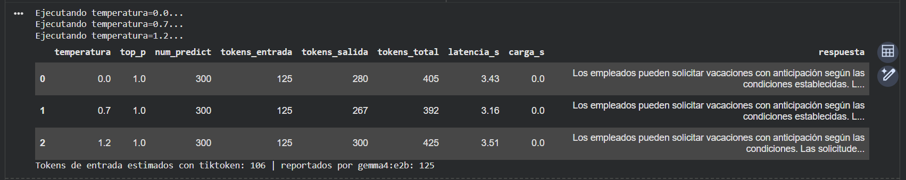
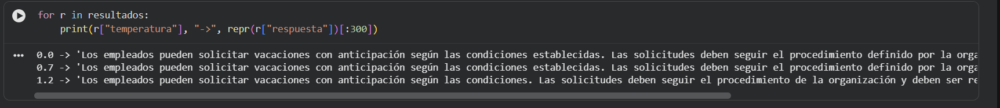
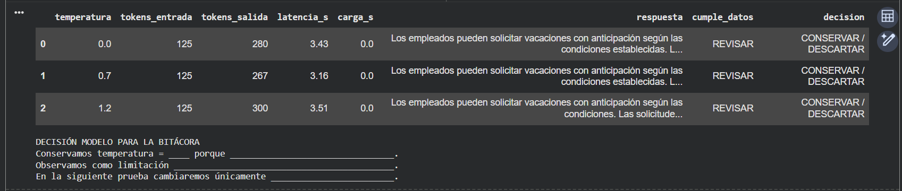

# Bitácora — Clase [02]

> [!tip] Cómo usar esta plantilla
> Duplica esta nota al finalizar cada clase y nómbrala `C##_AAAA-MM-DD_Tema`. Completa los campos entre corchetes y conserva enlaces verificables.

## 1. Datos de la sesión

| Campo    | Registro                                                                                                          |
| -------- | ----------------------------------------------------------------------------------------------------------------- |
| Tema     | Introducción a la Inteligencia Artificial Generativa y selección del proyecto semestral                           |
| Objetivo | Comprender la metodología de la electiva y seleccionar un proyecto que pueda evolucionar durante los tres cortes. |
| Proyecto | Buscador de conocimiento                                                                                          |
| Inicio   | 6:00 pm                                                                                                           |
| Cierre   | 10:00 pm                                                                                                          |

## 2. Participación y responsabilidades

| Integrante                 | Asistió | Rol de la clase       | Responsabilidad asumida                                                    | Aporte verificable                                                      |
| -------------------------- | :-----: | --------------------- | -------------------------------------------------------------------------- | ----------------------------------------------------------------------- |
| Joan Sebastian Sosa Bedoya |   Sí    | Integrante del equipo | Analizar la propuesta y aportar a la definición del objetivo del proyecto. | Aporte en la definición del objetivo y alcance inicial del proyecto.    |
| Alejandra Mejia Patiño     |   Sí    | Integrante del equipo | Participar en la selección y definición inicial del proyecto.              | Participación en la elección del proyecto **Buscador de conocimiento**. |

## 3. Reto aplicado al proyecto

### Funcionalidad trabajada
Se realizó una primera experimentación del Buscador de conocimiento, trabajando conceptos de tokenización, candidatos del siguiente token, temperatura y construcción de contexto. Se utilizaron documentos de ejemplo sobre seguridad de la información, trabajo remoto y gestión de proyectos para realizar consultas y analizar las respuestas generadas por el modelo.

### Criterios de aceptación
- [x]  Tokenizar y comparar frases relacionadas con documentación interna.
- [x]  Analizar cómo la temperatura modifica la distribución de probabilidad de los candidatos.
- [x]  Construir un contexto con instrucciones, documentos y una pregunta.
- [x]  Ejecutar la misma consulta con diferentes temperaturas.
- [x]  Registrar tokens, latencia y respuesta del modelo.
- [x]  Verificar que la respuesta sea pertinente y esté basada en los documentos proporcionados.
### Archivos o componentes modificados

- `Buscador_de_conocimiento.ipynb`: desarrollo de los ejercicios de tokenización, contexto, temperatura y ejecución del modelo.

## 4. Decisiones técnicas

| Decisión                              | Razón                                                                         | Alternativa descartada             |
| ------------------------------------- | ----------------------------------------------------------------------------- | ---------------------------------- |
| Usar un modelo local para las pruebas | Facilita experimentar y medir tokens, respuestas y tiempos.                   | Usar solamente una API externa.    |
| Proporcionar documentos como contexto | Busca que las respuestas estén basadas en información disponible.             | Responder sin contexto documental. |
| Comparar diferentes temperaturas      | Permite analizar el comportamiento del modelo y su impacto en las respuestas. | Mantener una temperatura fija.     |

## 5. Problemas y soluciones

| Problema encontrado                                        | Causa identificada                                                                             | Solución aplicada                                                        | ¿Cómo se verificó?                                                       |
| ---------------------------------------------------------- | ---------------------------------------------------------------------------------------------- | ------------------------------------------------------------------------ | ------------------------------------------------------------------------ |
| Diferencia entre palabras y tokens al procesar los textos. | Los modelos de lenguaje procesan el texto mediante tokens y no directamente como palabras.     | Se realizó la tokenización de las frases y se compararon los resultados. | Se revisó el número de palabras, tokens y piezas generadas.              |
| Diferencia entre palabras y tokens al procesar los textos. | La temperatura afecta la distribución de probabilidad de los candidatos durante la generación. | Se ejecutaron pruebas con diferentes valores de temperatura.             | Se compararon las respuestas y las métricas obtenidas en cada ejecución. |

## 6. Evidencias

| Tipo    | Descripción                                                                                                                                          | Enlace o ruta                        |
| ------- | ---------------------------------------------------------------------------------------------------------------------------------------------------- | ------------------------------------ |
| Captura | Resultados de la ejecución del modelo con temperaturas **0.0, 0.7 y 1.2**, mostrando tokens de entrada, tokens de salida, tokens totales y latencia. |  |
| Captura | Comparación de las respuestas generadas para la consulta sobre el procedimiento de vacaciones con diferentes temperaturas.                           |  |
| Captura | Notebook utilizado para realizar las pruebas de tokenización, contexto y generación de respuestas.                                                   |  |

## 7. Uso de inteligencia artificial

> [!important] Registrar la IA no reemplaza la explicación técnica. El equipo debe verificar, adaptar y comprender cualquier resultado utilizado.

| Herramienta | Objetivo o pregunta                                                         | Qué se utilizó                                                                     | Cómo se verificó                                                                           | Qué se modificó                                                                            |
| ----------- | --------------------------------------------------------------------------- | ---------------------------------------------------------------------------------- | ------------------------------------------------------------------------------------------ | ------------------------------------------------------------------------------------------ |
| ChatGPT     | Apoyar la adaptación y desarrollo de los ejercicios de IA para el proyecto. | Sugerencias de código, ejemplos de consultas y adaptación del contexto documental. | El equipo ejecutó y revisó el código, verificando las salidas, tokens y tiempos obtenidos. | Se ajustó el código y los ejemplos según las necesidades del **Buscador de conocimiento**. |

Si no se utilizó IA, escribir: **No se utilizó inteligencia artificial en esta sesión.**

## 8. Defensa técnica y retroalimentación

| Campo                     | Registro |
| ------------------------- | -------- |
| Integrante que defendió   |          |
| Pregunta recibida         |          |
| Respuesta resumida        |          |
| Retroalimentación docente |          |
| Mejora acordada           |          |

## 9. Aprendizajes

- **Concepto comprendido:** [Aprendizaje principal]
- **Algo que aún genera duda:** [Duda pendiente]
- **Qué haríamos diferente:** [Mejora del proceso]

## 10. Revisión antes de entregar

- [x] Todos los integrantes registraron un aporte verificable.
- [x] Los enlaces y rutas de evidencia funcionan.
- [x] Los criterios de aceptación están actualizados.
- [x] El uso de IA fue declarado y verificado.
- [x] El equipo puede explicar las decisiones registradas.

