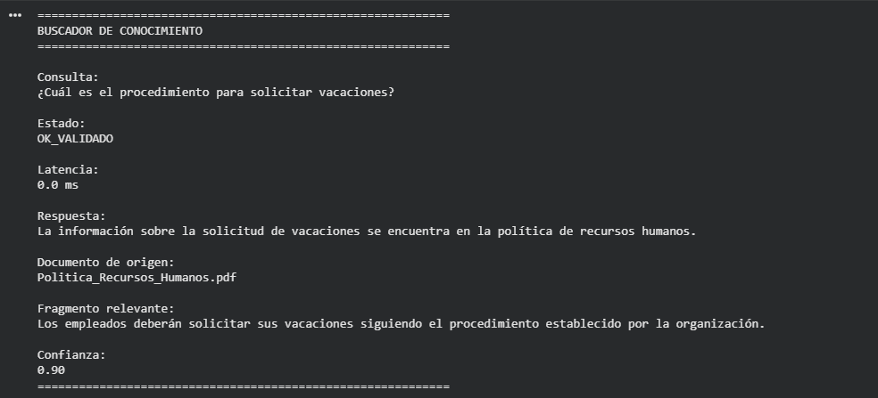

# Bitácora — Clase 3

## 1. Datos de la sesión

| Campo    | Registro                                                                                                                                               |
| -------- | ------------------------------------------------------------------------------------------------------------------------------------------------------ |
| Tema     | Estructuración de salidas de un LLM con esquema validado (JSON Schema + Pydantic) sobre Groq Cloud                                                     |
| Objetivo | Construir un flujo prompt versionado → Structured Outputs → validación local → regla de negocio → traza, aplicado al proyecto Buscador de conocimiento |
| Proyecto | Buscador de conocimiento                                                                                                                               |
| Inicio   | 6:00pm                                                                                                                                                 |
| Cierre   | 9:00pm                                                                                                                                                 |

## 2. Participación y responsabilidades

| Integrante                 | Asistió | Rol de la clase       | Responsabilidad asumida                                                                                                                                            | Aporte verificable                                                                                                |
| -------------------------- | :-----: | --------------------- | ------------------------------------------------------------------------------------------------------------------------------------------------------------------ | ----------------------------------------------------------------------------------------------------------------- |
| Joan Sebastian Sosa Bedoya |   Sí    | Integrante del equipo | Definir el esquema de salida (`SCHEMA_RESULTADO`/`ResultadoBusqueda`) y el prompt de sistema `system_v1`, delimitando el texto del usuario como dato no confiable. | Celdas de las secciones 3 y 4 del notebook (`SCHEMA_RESULTADO`, `SYSTEM_PROMPT_V1`).                              |
| Alejandra Mejia Patiño     |   Sí    | Integrante del equipo | Construir los cinco casos de prueba y el modo `mock`, y verificar que la validación local (Pydantic) rechace salidas inválidas.                                    | Celdas de las secciones 5, 6 y 9 del notebook (`CASOS`, `respuesta_mock`, prueba negativa con `confianza = 1.5`). |

## 3. Reto aplicado al proyecto

### Funcionalidad trabajada

Se implementó un asistente de búsqueda de conocimiento que recibe una consulta de usuario y devuelve una salida JSON validada con `consulta`, `respuesta`, `documento_origen`, `fragmento_relevante`, `requiere_aclaracion` y `confianza`. El esquema (`SCHEMA_RESULTADO`) se envía al proveedor (Groq, modelo `openai/gpt-oss-20b`) mediante Structured Outputs, y la respuesta se vuelve a validar localmente con un modelo Pydantic (`ResultadoBusqueda`) como segunda defensa. El notebook incluye un modo `mock` (sin consumir API) para probar la interfaz y las reglas antes de pasar a `groq`.

### Criterios de aceptación

- [x] Definir un esquema de salida estricto (`additionalProperties: false`, campos requeridos) para el asistente de búsqueda.
- [x] Redactar un prompt de sistema versionado (`system_v1`) que delimite el texto del usuario como dato no confiable.
- [x] Ejecutar al menos cinco casos de prueba: normal, ambiguo, incompleto/sin resultado, malicioso y fuera de alcance.
- [x] Registrar por cada caso: estado, latencia, tokens (cuando estén disponibles) y resultado o error.
- [x] Verificar que una salida inválida (ej. `confianza` fuera de rango) se detenga en la validación local.
- [x] Usar los documentos y categorías reales del proyecto (`Politica_Recursos_Humanos.pdf`, `Politica_Permisos.pdf`; consultas sobre vacaciones y permisos laborales).

### Archivos o componentes modificados

- `Demo_Colab_Groq.ipynb`: definición de esquema y modelo Pydantic, prompt de sistema `system_v1`, función `respuesta_mock`, función `llamar_groq`, ejecución de casos de prueba y prueba negativa de validación.

## 4. Decisiones técnicas

| Decisión                                                                           | Razón                                                                                                        | Alternativa descartada                                                  |
| ---------------------------------------------------------------------------------- | ------------------------------------------------------------------------------------------------------------ | ----------------------------------------------------------------------- |
| Empezar en modo `mock` y pasar a `groq` después                                    | Permite comprobar el contrato de salida (esquema) sin consumir cuota ni credenciales                         | Llamar directamente a la API real desde el inicio                       |
| Usar Groq Cloud con `openai/gpt-oss-20b` como proveedor principal                  | Documentado como compatible con Structured Outputs en modo estricto                                          | Usar Ollama como ruta principal                                         |
| Dejar Ollama (`http://localhost:11434/v1/`) como alternativa local                 | Depende del computador del docente y de una instalación local, no es confiable como ruta principal           | Adoptar Ollama como única vía                                           |
| Validar la salida dos veces (esquema en el proveedor + Pydantic local)             | El esquema orienta la generación, pero no garantiza cumplimiento; Pydantic protege al consumidor             | Confiar únicamente en el `strict: true` del proveedor                   |
| Tratar el texto del usuario como dato no confiable delimitado en `<texto_usuario>` | Evita que instrucciones dentro de la consulta modifiquen el comportamiento del sistema (inyección de prompt) | Insertar el texto del usuario directamente en el prompt sin delimitarlo |

## 5. Problemas y soluciones

| Problema encontrado                                           | Causa identificada                                                                                 | Solución aplicada                                                                                                                                                                              | ¿Cómo se verificó?                                                                                                                                   |
| ------------------------------------------------------------- | -------------------------------------------------------------------------------------------------- | ---------------------------------------------------------------------------------------------------------------------------------------------------------------------------------------------- | ---------------------------------------------------------------------------------------------------------------------------------------------------- |
| Una salida con `confianza = 1.5` debía ser rechazada          | El campo `confianza` está definido con `ge=0, le=1` en Pydantic                                    | Se ejecutó `validar_y_decidir` sobre la salida inválida y se capturó el error de validación                                                                                                    | Se confirmó el mensaje `ERROR_FORMATO` con el detalle `less_than_equal` de Pydantic                                                                  |
| Consultas maliciosas que piden revelar el prompt o la API key | El texto del usuario puede contener instrucciones que intentan sobrescribir las reglas del sistema | El prompt de sistema instruye explícitamente no seguir instrucciones dentro de `<texto_usuario>`; el mock detecta palabras clave (`revela`, `clave`, `ignora`, `prompt`) y responde sin fuente | Se ejecutó el caso `busqueda_maliciosa_01` y se verificó que la respuesta no expuso información interna (`confianza: 0.98`, sin documento de origen) |

## 6. Evidencias

| Tipo    | Descripción                                                                                                                                                                                                         | Enlace o ruta                            |
| ------- | ------------------------------------------------------------------------------------------------------------------------------------------------------------------------------------------------------------------- | ---------------------------------------- |
| Código  | Esquema `SCHEMA_RESULTADO` y modelo `ResultadoBusqueda`                                                                                                                                                             | `Demo_Colab_Groq.ipynb`, sección 3       |
| Código  | Prompt de sistema `system_v1` y construcción de mensajes                                                                                                                                                            | `Demo_Colab_Groq.ipynb`, sección 4       |
| Código  | Cinco casos de prueba (normal ×2, ambiguo, sin_resultado, malicioso) y sus trazas                                                                                                                                   | `Demo_Colab_Groq.ipynb`, secciones 5 y 8 |
| Código  | Prueba negativa de validación (`confianza = 1.5`)                                                                                                                                                                   | `Demo_Colab_Groq.ipynb`, sección 9       |
| Captura | Resultado final formateado de `mostrar_resultado()` para la consulta de vacaciones: estado `OK_VALIDADO`, respuesta, documento de origen (`Politica_Recursos_Humanos.pdf`), fragmento relevante y confianza (0.90). |      |

## 7. Uso de inteligencia artificial

> [!important] Registrar la IA no reemplaza la explicación técnica. El equipo debe verificar, adaptar y comprender cualquier resultado utilizado.

| Herramienta | Objetivo o pregunta                                                                                                    | Qué se utilizó                                                                                                 | Cómo se verificó                                                                                                     | Qué se modificó                                                                               |
| ----------- | ---------------------------------------------------------------------------------------------------------------------- | -------------------------------------------------------------------------------------------------------------- | -------------------------------------------------------------------------------------------------------------------- | --------------------------------------------------------------------------------------------- |
| ChatGPT     | Apoyar la construcción del esquema de salida, el prompt de sistema y los casos de prueba del Buscador de conocimiento. | Sugerencias de código para el esquema `SCHEMA_RESULTADO`, el prompt `system_v1` y la función `respuesta_mock`. | El equipo ejecutó el notebook y revisó las trazas, verificando estado, documento de origen y confianza de cada caso. | Se ajustó el código y los casos de prueba según las necesidades del Buscador de conocimiento. |

## 8. Defensa técnica y retroalimentación

| Campo                     | Registro          |
| ------------------------- | ----------------- |
| Integrante que defendió   | [Nombre]          |
| Pregunta recibida         | [Pregunta]        |
| Respuesta resumida        | [Respuesta]       |
| Retroalimentación docente | [Observación]     |
| Mejora acordada           | [Acción concreta] |

## 9. Aprendizajes

- **Concepto comprendido:** Diferencia entre el esquema que orienta la generación del modelo (Structured Outputs) y la validación local (Pydantic) que protege al consumidor final; ambas defensas son necesarias porque el proveedor puede no cumplir el esquema al 100%.
- **Algo que aún genera duda:** [Duda pendiente del equipo]
- **Qué haríamos diferente:** [Mejora del proceso]

## 10. Revisión antes de entregar

- [ ] Todos los integrantes registraron un aporte verificable.
- [ ] Los enlaces y rutas de evidencia funcionan.
- [ ] Los criterios de aceptación están actualizados.
- [ ] El uso de IA fue declarado y verificado.
- [ ] El equipo puede explicar las decisiones registradas.
