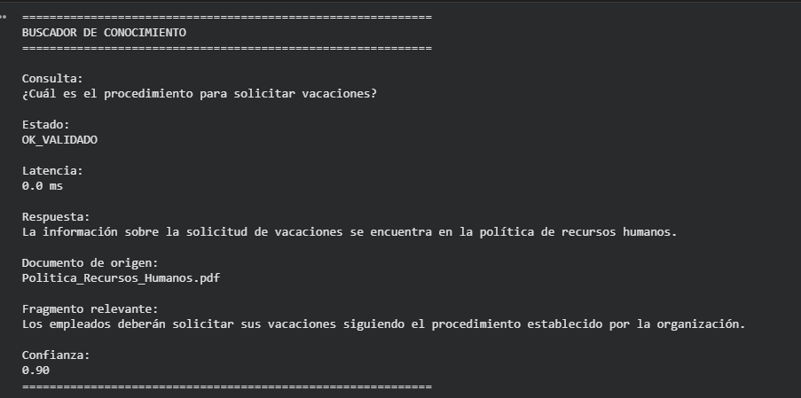

# Bitácora — Clase 4

## 1. Datos de la sesión

| Campo | Registro |
|---|---|
| Tema | Extensión del buscador de conocimiento con llamado a herramientas (tool calling): consulta de vigencia de documentos institucionales |
| Objetivo | Conservar el contrato de búsqueda (`ResultadoBusqueda`) y el prompt v1 de la Clase 3, y añadir una segunda llamada que proponga y ejecute, con validación, una herramienta de solo lectura para consultar la vigencia de un documento |
| Proyecto | Buscador de conocimiento |
| Inicio | 6:00pm |
| Cierre | 9:00pm |

## 2. Participación y responsabilidades

| Integrante                 | Asistió | Rol de la clase       | Responsabilidad asumida                                                                                                                                                                    | Aporte verificable                                                                                                   |
| -------------------------- | :-----: | --------------------- | ------------------------------------------------------------------------------------------------------------------------------------------------------------------------------------------ | -------------------------------------------------------------------------------------------------------------------- |
| Joan Sebastian Sosa Bedoya |   Sí    | Integrante del equipo | Definir el contrato de la herramienta (`ArgumentosDocumento`, `HERRAMIENTAS`) y el prompt `PROMPT_HERRAMIENTA`, validando que el código de documento propuesto siga el formato `DOC-XXXX`. | Celdas de las secciones 4 y 5 del notebook (`ArgumentosDocumento`, `HERRAMIENTAS`, `validar_llamada`).               |
| Alejandra Mejia Patiño     |   Sí    | Integrante del equipo | Construir la evaluación de 10 casos (`PRUEBAS`/`EVALUACION`) y las pruebas negativas sin API, verificando el fallo controlado y la inmutabilidad del repositorio ficticio.                 | Celdas de las secciones 9 y 10 del notebook (`EVALUACION`, prueba de `simular_fallo`, verificación de `DOCUMENTOS`). |

## 3. Reto aplicado al proyecto

### Funcionalidad trabajada

Se extendió el buscador de conocimiento de la Clase 3 sin reescribir su contrato: `ResultadoBusqueda` y el prompt `system_v1` se conservan intactos y se agregó un `system_v2` con reglas adicionales para consultas de vigencia. El nuevo recorrido usa dos llamadas separadas (nunca se mezclan JSON Schema y herramientas en una sola llamada): la primera clasifica la consulta con el esquema de búsqueda; la segunda, solo si la búsqueda quedó `OK_VALIDADO`, puede proponer la herramienta `consultar_estado_documento` (solo lectura, sin editar ni eliminar) sobre un repositorio ficticio de tres documentos (`DOC-1001`, `DOC-1002`, `DOC-1003`). Los argumentos propuestos por el modelo se validan dos veces: con un patrón Pydantic (`^DOC-[0-9]{4}$`, `strict=True`) y comprobando que el código realmente aparezca en el texto original del usuario, antes de ejecutar la consulta.

### Criterios de aceptación

- [x] Identificar qué búsqueda de la clase anterior se conserva (`ResultadoBusqueda`/`system_v1`) y qué dato externo necesita la aplicación (vigencia de un documento por código).
- [x] Integrar una herramienta de solo lectura (`consultar_estado_documento`), definiendo su entrada (`codigo_documento`), su fuente (`DOCUMENTOS`, repositorio ficticio) y el resultado (`encontrada`, `registro`).
- [x] Conservar las cinco pruebas anteriores (normal ×2, ambiguo, sin_resultado, malicioso) y agregar consultas de vigencia correctas, incompleta, desconocida y de intento de modificación.
- [x] Provocar un fallo de herramienta de forma controlada (`simular_fallo=True` → `ConnectionError`).
- [x] Registrar resultados y limitaciones reales de la ejecución en Obsidian (bitácora) — pendiente de completar con fecha, asistencia y defensa.

### Archivos o componentes modificados

- `Multimodalidad_Herramientas.ipynb`: recuperación del contrato y prompt de la Clase 3, definición de `SYSTEM_PROMPT_V2`, `PROMPT_HERRAMIENTA`, `ArgumentosDocumento`, `HERRAMIENTAS`, `validar_llamada`, `ejecutar_llamada`, función integrada `ejecutar()`, evaluación de 10 casos y pruebas negativas sin API.

## 4. Decisiones técnicas

| Decisión | Razón | Alternativa descartada |
|---|---|---|
| Separar la clasificación (JSON Schema) y la propuesta de herramienta en dos llamadas distintas | Evita mezclar `response_format` con `tools` en la misma petición, lo que simplifica la validación de cada etapa | Combinar esquema y herramientas en una sola llamada al modelo |
| Conservar `SYSTEM_PROMPT_V1` sin modificar y crear `SYSTEM_PROMPT_V2` como extensión | Permite comparar el comportamiento anterior con el nuevo y no arriesga romper el contrato ya validado en la Clase 3 | Reescribir el prompt original de la Clase 3 |
| Validar los argumentos de la herramienta dos veces (patrón Pydantic + verificación contra el texto original) | El modelo podría proponer un código válido en formato pero que no fue mencionado por el usuario | Confiar únicamente en la validación de formato de Pydantic |
| Limitar la herramienta a solo lectura y a una sola llamada por entrada | El prototipo solo debe consultar vigencia, nunca modificar registros, y evita ambigüedad si el modelo propone varias herramientas | Permitir múltiples llamadas o herramientas de escritura |
| Detener el flujo antes de proponer la herramienta si la búsqueda inicial no quedó `OK_VALIDADO` | Evita ejecutar una consulta de vigencia sobre una búsqueda que ya pidió aclaración o no tiene fuente | Proponer la herramienta sin importar el estado de la clasificación inicial |

## 5. Problemas y soluciones

| Problema encontrado | Causa identificada | Solución aplicada | ¿Cómo se verificó? |
|---|---|---|---|
| 8 de las 10 pruebas de la sección de evaluación (modo `groq` real) terminaron en estado `ERROR_API` en vez del estado esperado | Posible saturación o error transitorio del proveedor, agravado por `max_retries=0` (sin reintentos automáticos) y un `timeout` de 30 s que no da margen ante respuestas lentas | Se capturó el tipo de excepción (`type(exc).__name__`) en cada traza para diferenciar timeout de otros errores; se recomienda repetir la evaluación con reintentos manuales entre llamadas | Se comparó el campo `esperado` contra `obtenido` en la tabla `EVALUACION`; solo 3 de 10 casos coincidieron (`chequeo_estado: True`) |
| Un código de documento inventado por el modelo no debía ejecutarse si no aparecía en el texto del usuario | El modelo podría alucinar un código con formato válido pero no mencionado | `validar_llamada` compara el código propuesto contra los códigos `DOC-XXXX` encontrados por regex en el texto original | Prueba negativa: proponer `consultar_estado_documento` con un código no mencionado debe lanzar `ValueError` |
| No se presentó ningún otro problema distinto a los ya documentados | N/A | N/A | N/A |

## 6. Evidencias

| Tipo    | Descripción                                                                                                                                                                                           | Enlace o ruta                                        |
| ------- | ----------------------------------------------------------------------------------------------------------------------------------------------------------------------------------------------------- | ---------------------------------------------------- |
| Código  | Esquema de búsqueda recuperado (`SCHEMA_RESULTADO`/`ResultadoBusqueda`) y prompts `SYSTEM_PROMPT_V1`/`SYSTEM_PROMPT_V2`                                                                               | `Multimodalidad_Herramientas.ipynb`, secciones 2 y 3 |
| Código  | Definición de la herramienta (`ArgumentosDocumento`, `HERRAMIENTAS`, `validar_llamada`) y repositorio ficticio (`DOCUMENTOS`)                                                                         | `Multimodalidad_Herramientas.ipynb`, secciones 4 y 5 |
| Código  | Función integrada `ejecutar()` con las dos llamadas y manejo de etapas/errores                                                                                                                        | `Multimodalidad_Herramientas.ipynb`, sección 7       |
| Captura | Tabla de evaluación con 10 casos (`esperado` vs `obtenido`), mostrando que 8 terminaron en `ERROR_API`                                                                                                | `Multimodalidad_Herramientas.ipynb`, sección 9       |
| Código  | Pruebas negativas sin API: `confianza=1.5` rechazada, código no mencionado rechazado, fallo de herramienta simulado, código inexistente (`DOC-9999`) y verificación de que los registros no cambiaron | `Multimodalidad_Herramientas.ipynb`, sección 10      |
| Demo    | ZIP de evidencias exportado (`Clase04_continuacion_*.zip`) con prompts, esquemas, trazas y bitácora en JSON                                                                                           | `Adjuntos/Clase04_continuacion.zip`                  |
| Commit  | Extensión del buscador de conocimiento con la herramienta de consulta de vigencia (Clase 4)                                                                                                           |                  |

## 7. Uso de inteligencia artificial

> [!important] Registrar la IA no reemplaza la explicación técnica. El equipo debe verificar, adaptar y comprender cualquier resultado utilizado.

| Herramienta | Objetivo o pregunta | Qué se utilizó | Cómo se verificó | Qué se modificó |
|---|---|---|---|---|
| ChatGPT | Apoyar la extensión del buscador de conocimiento con la herramienta de consulta de vigencia, sin modificar el contrato de la Clase 3. | Sugerencias de código para `SYSTEM_PROMPT_V2`, `PROMPT_HERRAMIENTA`, `ArgumentosDocumento` y la función integrada `ejecutar()`. | El equipo ejecutó el notebook y revisó la tabla de evaluación, comparando el estado esperado contra el obtenido en cada caso. | Se ajustaron las reglas del prompt v2 y la validación de argumentos según las necesidades del prototipo de vigencia. |

## 8. Defensa técnica y retroalimentación

| Campo                     | Registro          |
| ------------------------- | ----------------- |
| Integrante que defendió   | [Nombre]          |
| Pregunta recibida         | [Pregunta]        |
| Respuesta resumida        | [Respuesta]       |
| Retroalimentación docente | [Observación]     |
| Mejora acordada           | [Acción concreta] |

## 9. Aprendizajes

- **Concepto comprendido:** Una respuesta correcta del modelo no demuestra que se haya ejecutado una consulta real: por eso se valida el argumento propuesto contra el texto original antes de llamar a la herramienta, y se distingue `RESPUESTA_DIRECTA` de `OK_CONSULTA` en la traza.
- **Algo que aún genera duda:**  [Duda pendiente del equipo]
- **Qué haríamos diferente:**  [Mejora del proceso]

## 10. Revisión antes de entregar

- [ ] Todos los integrantes registraron un aporte verificable.
- [ ] Los enlaces y rutas de evidencia funcionan.
- [ ] Los criterios de aceptación están actualizados.
- [ ] El uso de IA fue declarado y verificado.
- [ ] El equipo puede explicar las decisiones registradas.
