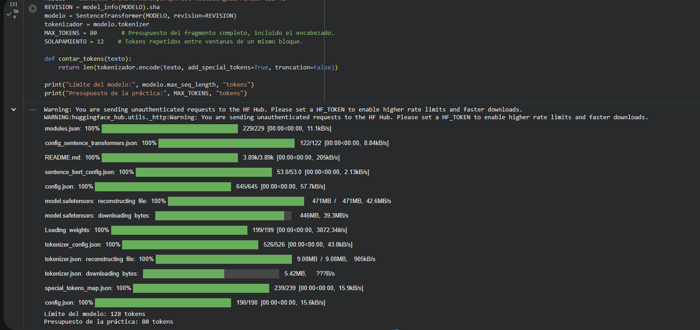
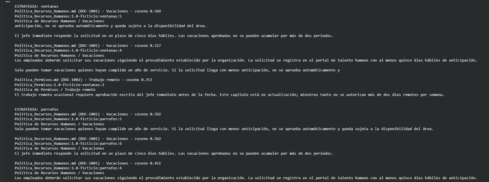
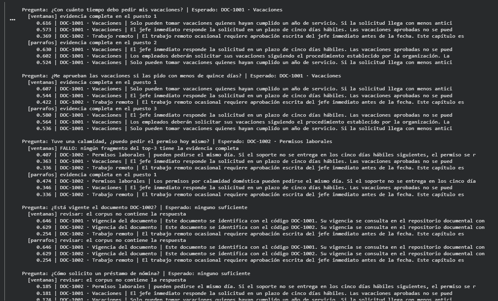
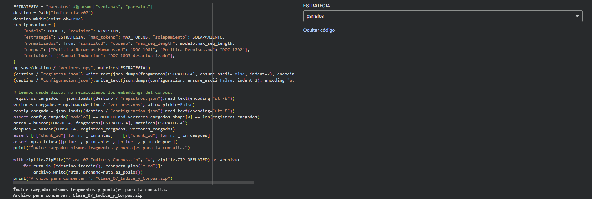

# Bitácora — Clase 7

## 1. Datos de la sesión

| Campo    | Registro                                                                                                                                                                                                       |
| -------- | -------------------------------------------------------------------------------------------------------------------------------------------------------------------------------------------------------------- |
| Tema     | De los documentos al índice: ingestión, limpieza, fragmentación e índice persistente                                                                                                                           |
| Objetivo | Preparar documentos del proyecto, compararlos con dos estrategias de fragmentación (ventanas y párrafos), guardar el índice con su configuración y comprobar que al volver a cargarlo devuelve los mismos resultados. |
| Proyecto | Buscador de conocimiento                                                                                                                                                                                       |
| Inicio   | 6:00                                                                                                                                                                                                           |
| Cierre   | 9:30                                                                                                                                                                                                           |

## 2. Participación y responsabilidades

| Integrante                 | Asistió | Rol de la clase       | Responsabilidad asumida                                                                        | Aporte verificable                                                                 |
| -------------------------- | ------- | --------------------- | ---------------------------------------------------------------------------------------------- | ---------------------------------------------------------------------------------- |
| Joan Sebastian Sosa Bedoya | Sí      | Integrante del equipo | Ejecutar el notebook, generar el índice y verificar que el índice cargado repite los resultados. | Ejecución completa del notebook y `Clase_07_Indice_y_Corpus.zip`.                  |
| Alejandra Mejia Patiño     | Sí      | Integrante del equipo | Preparar el corpus del proyecto, escribir las preguntas de prueba y analizar los fallos.         | Corpus DOC-1001 / DOC-1002, tabla de cinco pruebas con evidencia esperada y fallos registrados. |

## 3. Reto aplicado al proyecto

### Funcionalidad trabajada

Ingestión del corpus del Buscador de conocimiento. Viene de la Clase 6, donde se buscaba sobre cinco pasajes escritos a mano; ahora el buscador lee **documentos completos desde una carpeta**, los limpia, los divide en fragmentos con metadatos (documento, código, sección, versión, huella SHA-256) y guarda un **índice persistente** (vectores + registros + configuración) que se puede volver a cargar sin recalcular los embeddings. Se compararon dos estrategias de fragmentación con cinco preguntas escritas antes de ver los resultados. Todavía no se genera una respuesta con los fragmentos (corresponde a la Clase 08).

### Criterios de aceptación

- [x] Leer los documentos desde una carpeta y conservar archivo, título, versión, código y huella del original.
- [x] Limpiar espacios y líneas sobrantes sin alterar párrafos, negaciones ni condiciones (DOC-1001: 1020 → 1017 caracteres; DOC-1002: 881 → 879).
- [x] Fragmentar con dos estrategias (ventanas con solapamiento y párrafos) respetando el presupuesto de 80 tokens y el límite del modelo (128).
- [x] Incluir título y sección en el texto vectorizado de cada fragmento para poder volver a la fuente.
- [x] Comparar las dos estrategias con la misma consulta y con la batería de cinco pruebas.
- [x] Elegir una estrategia y justificarla.
- [x] Guardar el índice (vectores, registros, configuración), volver a cargarlo y comprobar que devuelve los mismos fragmentos y puntajes.
- [x] Excluir el documento desactualizado (`Manual_Induccion`, DOC-1003) y dejarlo registrado en la configuración.
- [x] Registrar al menos un fallo observado con su explicación.

### Archivos o componentes modificados

- `Buscador Ingestion Indice.ipynb`: corpus con `Politica_Recursos_Humanos.md` (DOC-1001) y `Politica_Permisos.md` (DOC-1002), funciones de fragmentación, búsqueda, guardado/carga del índice y sección 7 (batería de cinco pruebas con evidencia esperada y frases obligatorias).
- `indice_clase07/` → `vectores.npy`, `registros.json`, `configuracion.json`.
- `Clase_07_Indice_y_Corpus.zip`: índice + documentos fuente, para conservarlos fuera de la sesión de Colab.

## 4. Decisiones técnicas

| Decisión | Razón | Alternativa descartada |
| --- | --- | --- |
| Mismo modelo de la Clase 6 (`paraphrase-multilingual-MiniLM-L12-v2`) fijado con su `revision` | Si cambia el modelo, cambian los vectores; fijar la revisión garantiza que el índice guardado y las consultas usen la misma representación. | Cargar siempre la última versión del modelo. |
| Presupuesto de 80 tokens por fragmento (incluido el encabezado), por debajo del límite de 128 | Evita que el modelo recorte el texto en silencio al generar el embedding. Se valida con `contar_tokens` y se lanza error si se supera. | Fragmentar por número de caracteres sin contar tokens. |
| Encabezado «Título / Sección» dentro de cada fragmento | Da contexto al vector y permite volver a la fuente; sin él, fragmentos como «pueden pedirse el mismo día…» quedan sin tema. | Vectorizar solo el cuerpo y guardar la sección aparte. |
| Solapamiento de 12 tokens en ventanas | Reduce la pérdida de información en los cortes entre ventanas de una misma sección. | Ventanas sin solapamiento. |
| **Estrategia elegida: párrafos** | Cada fragmento contiene una regla completa (condición + consecuencia) y ningún fragmento empieza o termina a mitad de frase. Fue la única que encontró la evidencia completa en las tres preguntas con respuesta. | Ventanas: cortó la excepción de calamidad doméstica y la regla de poca anticipación (ver sección 5). |
| Búsqueda exacta con matriz NumPy (`matriz @ vector`) | Con 9 fragmentos no hace falta una base vectorial; la búsqueda exacta es simple y verificable. | Instalar una base de datos vectorial. |
| Guardar configuración junto a los vectores (modelo, revisión, estrategia, tokens, solapamiento, corpus, excluidos) | Sin la configuración no se sabe con qué se construyó el índice ni si una consulta nueva es compatible. | Guardar solo `vectores.npy`. |

## 5. Problemas y soluciones

| Problema encontrado | Causa identificada | Solución aplicada | ¿Cómo se verificó? |
| --- | --- | --- | --- |
| **Fallo:** con *ventanas*, «Tuve una calamidad, ¿puedo pedir el permiso hoy mismo?» no tuvo la evidencia completa en el top-3. El primer resultado (0.407) empezaba en «pueden pedirse el mismo día…», sin la frase «calamidad doméstica». | La ventana 0 se cortó en «Si el soporte no se…» y la ventana 1 arrancó a mitad de la regla. La frase completa quedó repartida en dos fragmentos, y la ventana 0 mezclaba también el párrafo general de permisos. | Usar la estrategia *párrafos*: el párrafo de calamidad queda completo y sale primero (0.474). | Batería de la sección 7: *ventanas* → FALLO; *párrafos* → evidencia completa en el puesto 1. |
| Con *ventanas*, la regla de vacaciones quedó partida: la ventana 4 termina en «…no se aprueba automáticamente y» y la consecuencia «queda sujeta a la disponibilidad del área» pasó a la ventana 5. | Corte por número de tokens sin respetar los límites de frase. El solapamiento de 12 tokens repite parte de la frase, pero no la conserva completa en ningún fragmento. | Fragmentar por párrafos. | Lectura de los fragmentos: el párrafo 5 contiene la condición y la consecuencia juntas. |
| Con *párrafos*, para «¿Me aprueban las vacaciones si las pido con menos de quince días?» el párrafo que responde quedó **tercero** (0.536), detrás de «El jefe inmediato responde…» (0.580) y «…quince días hábiles de anticipación» (0.564). | Los tres párrafos son de la misma sección y comparten vocabulario (vacaciones, solicitud, días hábiles); la similitud coseno los separa poco. | Se mantiene `k = 3` para que el fragmento correcto entre en los candidatos; se registra como riesgo para la Clase 08. | Puntajes de la batería: diferencia de 0.044 entre el primero y el tercero. |
| «¿Está vigente el documento DOC-1002?» devolvió primero la vigencia de **DOC-1001** (0.646) y después la de DOC-1002 (0.629). | Los dos fragmentos de vigencia son casi idénticos y solo cambia el código; el modelo de embeddings no distingue bien códigos como `DOC-1001` / `DOC-1002`. Además, ninguno contiene el estado actual. | No responder con el corpus: la vigencia se consulta en la herramienta del repositorio documental (Clase 4). | Se leyó el texto: «este texto no contiene el estado actual del documento». |
| «¿Cómo solicito un préstamo de nómina?» devolvió candidatos (máximo 0.209). | Siempre existe un «más cercano», aunque ningún fragmento trate el tema. | Leer los textos y concluir que el corpus no tiene cobertura. | Ningún fragmento menciona préstamos; los puntajes son los más bajos de la batería. |

### Fragmentos generados

| Estrategia | Fragmentos | Tokens por fragmento | Máximo |
| --- | --- | --- | --- |
| Ventanas | 8 | 78, 45, 50, 48, 78, 63, 56, 48 | 78 |
| Párrafos | 9 | 58, 53, 50, 48, 47, 49, 42, 56, 48 | 58 |

Matrices de embeddings: ventanas `(8, 384)`, párrafos `(9, 384)`.

### Resultados de la batería de pruebas (`k = 3`)

| # | Pregunta | Esperado | Ventanas | Párrafos | Lectura |
| --- | --- | --- | --- | --- | --- |
| 1 | ¿Con cuánto tiempo debo pedir mis vacaciones? | DOC-1001 · Vacaciones | Puesto 1 (0.616) | Puesto 2 (0.602) | Ambas aciertan; en párrafos el primero (0.630) es «el jefe responde en cinco días», un distractor. |
| 2 | ¿Me aprueban las vacaciones si las pido con menos de quince días? | DOC-1001 · Vacaciones (condición + consecuencia) | Puesto 1 (0.607) | Puesto 3 (0.536) | Ventanas sube primero, pero con la consecuencia cortada; párrafos la conserva completa, aunque en tercer lugar. |
| 3 | Tuve una calamidad, ¿puedo pedir el permiso hoy mismo? | DOC-1002 · Permisos laborales | **FALLO** | Puesto 1 (0.474) | La ventana partió la excepción. |
| 4 | ¿Está vigente el documento DOC-1002? | Ninguno suficiente | DOC-1001 · Vigencia (0.646) | DOC-1001 · Vigencia (0.646) | Documento equivocado primero y sin el dato: se consulta en el repositorio. |
| 5 | ¿Cómo solicito un préstamo de nómina? | Ninguno suficiente | 0.185 | 0.209 | Sin cobertura. |

Otras consultas probadas:

- «¿Me aprueban las vacaciones si las pido con poca anticipación?» (consulta del punto 5). Ventanas: ventana 5 (0.569). Párrafos: párrafo 5 (0.592), que contiene la regla completa.
- «¿Puedo trabajar desde casa toda la semana?». Ambas estrategias devuelven *Trabajo remoto* (0.520): «no se autorizan más de dos días remotos por semana».

### Persistencia del índice

Se guardó con la estrategia **párrafos**, se volvió a cargar desde disco y se repitió la consulta. El resultado fue «Índice cargado: mismos fragmentos y puntajes para la consulta». Las aserciones del notebook comprobaron que coinciden el modelo, la cantidad de vectores y registros, el orden de `chunk_id` y los puntajes (`np.allclose`).

## 6. Evidencias

| Tipo    | Descripción                                                                                | Enlace o ruta                        |
| ------- | ------------------------------------------------------------------------------------------ | ------------------------------------ |
| Captura | Limpieza del corpus y muestra de fragmentos de las dos estrategias (tokens por fragmento). |  |
| Captura | Consulta del punto 5 comparando ventanas y párrafos.                                       |  |
| Captura | Batería de cinco pruebas (sección 7) con el FALLO de ventanas en la pregunta de calamidad. |  |
| Captura | Mensaje «Índice cargado: mismos fragmentos y puntajes para la consulta».                   |  |
| Archivo | Índice y documentos del corpus.                                                            | `Clase_07_Indice_y_Corpus.zip`       |

## 7. Uso de inteligencia artificial

> [!important] Registrar la IA no reemplaza la explicación técnica. El equipo debe verificar, adaptar y comprender cualquier resultado utilizado.

| Herramienta | Objetivo o pregunta | Qué se utilizó | Cómo se verificó | Qué se modificó |
| --- | --- | --- | --- | --- |
| Claude | Revisar el notebook de la Clase 7, ejecutarlo y completar la bitácora a partir de la de la Clase 6. | Ejecución del código del notebook, lectura de los fragmentos y puntajes, borrador de las secciones 3, 4, 5 y 9. | El equipo vuelve a ejecutar el notebook en Colab y contrasta los puntajes y el FALLO de la batería con esta bitácora. | Se completaron los datos de la Clase 7 (antes la bitácora era una copia de la Clase 6), las tablas de resultados y la justificación de la estrategia elegida. |

## 8. Defensa técnica y retroalimentación

| Campo | Registro |
| --- | --- |
| Integrante que defendió | |
| Pregunta recibida | |
| Respuesta resumida | |
| Retroalimentación docente | |
| Mejora acordada | |

## 9. Aprendizajes

- **Concepto comprendido:** La forma de fragmentar cambia lo que el buscador puede recuperar. Si un corte separa una condición de su consecuencia, el fragmento puede parecer pertinente pero no basta para responder. Que la búsqueda acierte en el primer puesto no garantiza que el fragmento tenga la evidencia completa. Además, un índice solo sirve si se guarda con su configuración (modelo, revisión, estrategia, tokens), porque las consultas deben usar la misma representación.
- **Algo que aún genera duda:** Cómo hacer que el buscador distinga códigos casi iguales como `DOC-1001` y `DOC-1002`, y si conviene combinar la búsqueda semántica con una búsqueda literal para identificadores.
- **Qué haríamos diferente:** Revisar los fragmentos generados antes de lanzar las consultas, y añadir a la batería la comprobación del texto completo de la consecuencia, no solo de las frases clave.

## 10. Revisión antes de entregar

- [ ] Todos los integrantes registraron un aporte verificable.
- [ ] Los enlaces y rutas de evidencia funcionan.
- [ ] Los criterios de aceptación están actualizados.
- [ ] El uso de IA fue declarado y verificado.
- [ ] El equipo puede explicar las decisiones registradas.
